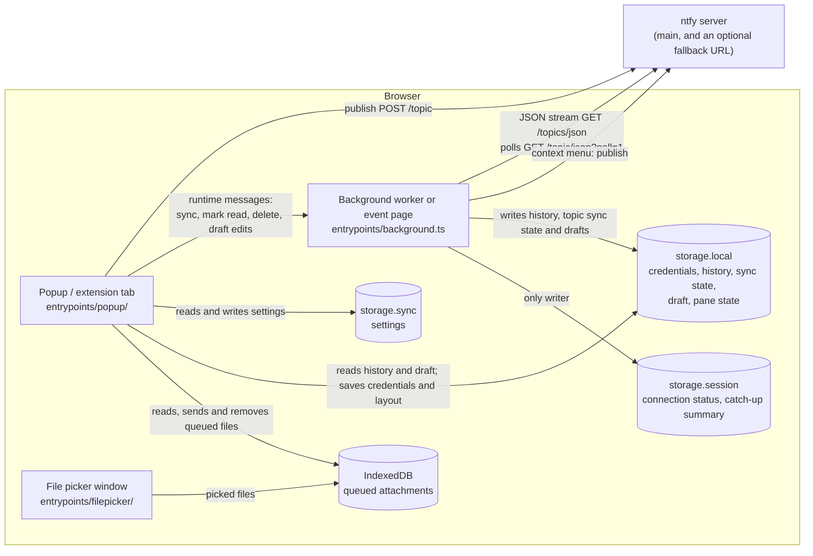

# Architecture

How ntfy Desk works. See [README.md](README.md) for installation and setup, and [AGENTS.md](AGENTS.md) for repository conventions and commands.

ntfy Desk is a Manifest V3 browser extension for Chrome (and Chromium browsers) and Firefox, built with [WXT](https://wxt.dev) and TypeScript. It does two things against an [ntfy](https://ntfy.sh) server:

- **Send**: publish a message, optionally with attachments, to a topic (from the popup, the right-click menu or a keyboard shortcut).
- **Receive**: subscribe to topics, show desktop notifications, keep a message list per topic and an unread count on the toolbar icon.

## Overview



The background owns the subscription, catch-up polls, received-message history, desktop notifications, unread badge and context menu. It runs as a service worker on Chromium and as an event page on Firefox. The popup and extension tab share the same page for sending, browsing the inbox and editing settings. They communicate with the background through storage and runtime messages.

## Components

| Path | Role |
|---|---|
| `entrypoints/background.ts` | Registers every listener at startup (MV3 requires it): storage changes, the one-minute alarm, the context menu, keyboard commands, notification clicks, messages from the popup. Starts the receiver. |
| `entrypoints/popup/` | Send form and its disclosure preference (`send.ts`), inbox (`receive.ts`), settings (`settings.ts`) and resizable dividers (`pane-dividers.ts`). `?mode=page` selects the browser-tab layout. |
| `entrypoints/filepicker/` | A small window for picking files: the popup closes as soon as a file dialog opens, so files are picked here and stored for the popup. |
| `utils/ntfy.ts` | The ntfy API: configuration (`getConfig`), authentication headers, publishing, polls, the subscription stream, message validation (`parseMessage`). |
| `utils/receiver.ts` | Receiving: the subscription stream, the per-topic polls, reconnects, the service worker keepalive, the connection status. |
| `utils/history.ts` | Received messages, read and deleted ids, per-topic sync state; one write queue. |
| `utils/delete.ts`, `utils/sync-modes.ts` | Local and remote deletion requests and the per-topic opt-in to server deletion sync. |
| `utils/servers.ts` | Health checks and selection of the main or fallback server. |
| `utils/notifications.ts` | Desktop notifications (with `view` action buttons), notification clicks, the unread badge. |
| `utils/rules.ts` | Per-topic notification rules: all, from a priority up, or off. |
| `utils/status.ts` | The receiver's connection state for the inbox. |
| `utils/messages.ts` | Requests from the popup to the background, validated. |
| `utils/context-menu.ts` | Right-click menu: send the page, selection, link or image to a topic. Also the page send of the keyboard command. |
| `utils/commands.ts` | The manifest's keyboard commands: the `send-page` handler, the list of bindings and the browser's shortcut settings. |
| `utils/preferences.ts` | Customization preferences with their choices and defaults: badge scope, notification persistence, history limit, message times, density, topic list layout. |
| `utils/backup.ts` | Export and import of the synced settings as a JSON file: the file format, validation of an imported file, the import preview and the one write. |
| `utils/markdown.ts` | A small Markdown renderer that builds DOM nodes (no `innerHTML`). |
| `utils/zip.ts`, `utils/stored-files.ts` | Several attachments as one ZIP; attachments waiting for the next send. |
| `utils/extension-tab.ts` | Opens or focuses the extension's own tab. |

## Configuration and storage

| Area | Keys | Why there |
|---|---|---|
| `storage.sync` | `apiUrl`, `fallbackUrl`, `topics`, `includeUrl`, `notifyRules`, `syncDeletionTopics`, `topicSendDefaults`, `theme`, `priority`, `lastTags`, `lastTopic`, `sendAnotherEnabled`, `sendAsZipEnabled`, `freezeDividers`, `rememberSendPanel`, `badgeScope`, `keepUrgentOnScreen`, `historyPerTopic`, `messageTimes`, `inboxDensity`, `topicLayout` | Settings follow the user to their other browsers. Credentials belong in local storage. |
| `storage.local` | `accessToken`, `serverCredentials`, `authOrigins` | Credentials stay on this device. |
| `storage.local` | `receivedNotifications`, `readMessageIds`, `deletedMessageIds`, `topicSync` | Received messages and the sync state, per device. |
| `storage.local` | `draftState`, `receiveTopicFilter`, `storedFilesRevision` | Draft, last inbox filter, and a revision of the attachment queue that changes after every edit so other views reload it. `receiveTopicFilter` stores `{ topic }` for a specific topic or `null` for All topics. |
| `storage.local` | `popupTopicsPaneWidth`, `popupSendPaneWidth`, `topicsPaneWidth`, `sendPaneWidth`, `sendPanelOpen`, `sendOptionsOpen` | Pane widths are separate for the popup and tab. The remembered Send disclosure state is shared on this device, and so is whether the composer's "More options" is open (always remembered). |
| `storage.session` | `receiverStatus` | Connection status is kept for the current extension session. |
| `storage.session` | `catchUpSummary` | The open catch-up summary notification (count, topic, whether it includes high or urgent messages), so a later catch-up adds to it; cleared when it is clicked. |
| IndexedDB `ntfy-desk-attachments` | store `files`: id, name, type, size, Blob, order | Attachments waiting for the next send, as Blobs rather than data URLs, so an edit never rewrites the whole queue. Shared by the popup, the tab, the file picker window and the background. |

v1.0.0 is the first release, so the code reads only these formats: there is no migration code, and data in an older shape is ignored or dropped (still validated).

`getConfig()` in `utils/ntfy.ts` is the one place that assembles the configuration for requests. It:

- reads the server URLs and topics from `storage.sync` and the token and username/password from `storage.local`;
- strips `user:password@`, query strings and fragments from the synced URLs (writing the cleaned values back) and clears invalid URL values; credentials found in a URL are discarded, never used;
- withholds the credentials from server origins not approved on this device (see [Security model](#security-model)).

The customization preferences (`utils/preferences.ts`) are `badgeScope` (`all` or `notifying`), `keepUrgentOnScreen` (boolean), `historyPerTopic` (50, 100, 250 or 500), `messageTimes` (`relative` or `absolute`), `inboxDensity` (`comfortable` or `compact`) and `topicLayout` (`side` or `top`). `parsePreferences` validates each value on reading and falls back to its default, which is the behaviour without the setting; reading never writes. Each control in the settings saves only its own key. The open views and the background follow `storage.onChanged`, so a change in one view, or from browser sync, applies without a reload.

Data keyed by topic is stored as lists (`[topic, value]` pairs, or objects with a `topic` field) and read into a `Map`, because topic names such as `__proto__` are valid in ntfy and break plain objects.

### Export and import

Backup in the settings moves the configuration to another browser without browser sync (`utils/backup.ts`). The file is JSON:

```json
{ "format": "ntfy-desk-settings", "version": 1, "exportedAt": "2026-11-17T08:30:00.000Z", "settings": { "apiUrl": "https://ntfy.example", "topics": ["alerts"], "theme": "dark" } }
```

- **What is in it.** `settings` holds every `storage.sync` key of the table above under its storage name and in its storage shape, except `topics`, which is a list. That includes the values used last (`priority`, `lastTags`, `lastTopic`) and the composer toggles: an import then restores the same state browser sync would, and no key needs a rule of its own. A unit test compares the exported keys with the table. Nothing from `storage.local`, `storage.session` or IndexedDB is exported: `buildBackup` reads `storage.sync` only, so the token, the username and password, `authOrigins`, the history, drafts and attachments can't end up in a file. Pane widths and the disclosure states stay out with them: they are per device by design.
- **Version.** `version` is a whole number. A file with a higher one is refused with a message to update; new keys an older reader can ignore don't raise it.
- **Validation.** Export and import share `sanitizeSettings`, which builds the settings from untrusted values with the validators used when storage is read (`isHttpUrl` and `splitCredentials`, `isNtfyPathPart`, `parseTopicRules`, `parseSyncDeletionTopics`, `parseSendDefaults`, `parsePreferences`). So an export contains only values the app would use, and an import stores only values those validators returned. A file is refused as a whole when it is over 256 KiB (checked on the file's size before reading it), isn't JSON, has another `format`, a newer or unusable `version`, or no `settings` object. Inside `settings`, unknown keys are ignored, a missing value is the default, and an invalid one is also the default and named in the confirmation ("not imported"). Userinfo, query strings and fragments are removed from server URLs and the credentials in them discarded. Per-topic entries and `lastTopic` of topics that aren't in the imported list are dropped. A value that wouldn't fit one `storage.sync` item (8,192 bytes) is not imported.
- **Confirmation.** Picking a file writes nothing. The Backup group shows the server URLs and topic counts before and after, that all other settings are replaced, what was left out, and the origins the credentials will be held back from. **Replace settings** then runs under the settings lock, checks that the settings are still the ones the preview compared with, and writes every key in one `storage.sync.set` (replace, not merge; one write for the sync write-rate limits).
- **Credentials.** An import never writes credentials and never approves a server. With approvals recorded, `getConfig` holds the credentials back from an imported origin outside `authOrigins`, as for a URL changed through sync. A device that has recorded no approvals yet would approve whatever servers `getConfig` finds next with credentials; so before the settings are written, `importSettings` records the servers configured before the import (possibly none) as the approved ones. This happens whether or not credentials are stored at the time, so a token saved after an import is held back from the imported server until the user confirms it. Credentials are held back from the whole configuration, main and fallback, when any one of its origins isn't approved: an import that changes only the fallback URL also stops authentication to an unchanged main server until the user confirms. The approvals and the settings are written under a Web Lock (`withAuthOriginsLock`) that `getConfig` also takes, re-reading storage, before it records first-time approvals: a read that raced with the import cannot approve the imported server. The confirmation also says when a lower history limit will delete older messages.
- **After the write.** The background follows `storage.onChanged` as for any settings change: the context menu is rebuilt, the receiver reconnects, the badge and the history limit are applied. The importing view reloads its settings form; every open view follows the preferences, theme, topic settings and composer toggles through its storage listeners. Server URLs in another open view stay as they were until Settings is reopened, and its "Save server settings" refuses to write them back (the baseline check).
- **Download and file dialog.** Export is a Blob URL on a link with `download`, which needs no `downloads` permission. In Chromium it works in the toolbar popup too (covered by an end-to-end test with the real popup). Firefox's popup closes when a save dialog takes the focus, which discards the Blob, so there the button opens the extension's tab at the Backup group. Import needs a file dialog, which can close the popup (the reason for the attachment picker window), and a confirmation that must outlast it: from the popup the button always opens the tab (`#settings=backup`), where the user chooses the file.

## Receiving

Receiving combines a **live subscription** with **per-topic polls**:

```mermaid
sequenceDiagram
  participant SW as Service worker (receiver)
  participant N as ntfy server
  participant S as storage.local

  SW->>N: GET /<topic>/auth for each topic (readable?)
  SW->>N: GET /<readable topics>/json (Authorization header)
  N-->>SW: 200, then one JSON line per event
  SW->>N: GET /<topic>/json?poll=1&since=<watermark> per topic
  N-->>SW: missed messages
  SW->>S: record (dedupe, history, sync state in one write)
  loop every 20 s while subscribed
    SW->>SW: runtime.getPlatformInfo() (keeps the worker alive)
  end
  N-->>SW: message line
  SW->>S: record; desktop notification if new
  Note over SW: Every minute (alarm): connect() and sync()
```

### Connecting

`receiver.connect()` runs when the service worker starts, when the settings or credentials change, and every minute from an alarm. Each run:

1. Reads `getConfig()`. Without a server or topics it stops and shows nothing.
2. Picks the server (`pickServer`): the main URL if `/v1/health` answers or there's no fallback, else the fallback if it answers. Checking every minute lets it switch back when the main server returns.
3. Checks read access per topic (`GET /<topic>/auth`). ntfy rejects a multi-topic subscription with 403 if any topic isn't readable, and a topic the token can only publish to is a normal setup, so the receiver subscribes to (and polls) the readable topics only. The inbox marks the others "send only". The result is cached for an hour, or until a subscription is refused.
4. Subscribes, unless the current subscription already has the same server, topics and authentication.

A `connect()` that an `await` made stale (the settings changed meanwhile) stops instead of subscribing with old settings (`connectGeneration`).

### The subscription stream

The subscription is ntfy's JSON stream: `GET /<topic1>,<topic2>/json`, answered with `200` and then one JSON object per line: an `open` event, `message` events, and a `keepalive` event every 45 seconds by default. It is an ordinary `fetch` with the `Authorization` header (`openMessageStream`), read line by line (`readLines`):

- Each chunk is read only after the lines before it were stored, so a server sending faster than the extension can store is slowed down by TCP rather than queued in memory.
- Each line goes through `parseMessageJson`. Subscribed topics record `message` events, and topics with deletion sync enabled also apply `message_delete` events.
- A line longer than `MAX_MESSAGE_JSON` is dropped.

The stream ends in one of four ways, each followed by a reconnect with backoff (5 s doubling to 60 s): the server closes it, the network fails, the server refuses it (an HTTP error; a refusal before it opened also discards the cached read-access check), or nothing arrives for `STREAM_IDLE_TIMEOUT` (150 s). The last one matters because a connection that dies silently produces no event on a stream. Until the response headers arrive, the limit is `STREAM_CONNECT_TIMEOUT` (20 s), so a server or proxy that accepts the connection and never answers doesn't leave the subscription connecting for good.

### Keeping the service worker alive

Chrome stops an extension service worker after 30 seconds without activity. Incoming data on a `fetch` stream doesn't count as activity, but an extension API call does, so while subscribed the receiver calls `browser.runtime.getPlatformInfo()` every 20 seconds (`KEEPALIVE_INTERVAL`). If the worker is stopped anyway (browser idle, update, crash), the one-minute alarm starts it again, and the polls fetch what it missed. Install and browser start create the alarm; the background also checks for it at every start (`ensureReceiverAlarm` in `utils/schedule.ts`) and creates it again when a browser dropped it, as Firefox does when an add-on is disabled and enabled again. Chromium 116 is the oldest supported version (`minimum_chrome_version`): `runtime.getContexts`, and service workers kept alive by extension API calls (110).

### Catch-up polls and deduplication

Live messages alone would miss everything published while the browser was closed or the stream was down. So every topic is also polled: when the stream opens, every minute, and when the popup opens.

Each topic has a sync state in `topicSync`:

- `origins` identifies the main and fallback aliases. An unrelated server starts with a fresh poll.
- `since` holds the newest event time a poll covered: a completed poll, or the recorded prefix of one that hit the scan limit (below, with the step past a saturated second). The next poll asks for `since=<watermark>` (inclusive). An empty first poll seeds the cursor one minute before the server's Date header when visible and no more than a day ahead of this device's clock (`MAX_CLOCK_AHEAD`). Otherwise later polls use the time elapsed since `emptyPollAt` plus one minute until an event provides a server timestamp. Live events leave the watermark in place so the next poll can catch up on earlier events.
- `seen` tracks the id and time of events at or after the watermark to deduplicate the inclusive replay, at most 5,000 per topic (`MAX_SEEN_PER_TOPIC`, a safety cap for polls that keep failing while live messages arrive).
- `serverDeletions` tracks up to 1000 recent deletion events by sequence ID, so overlapping live delivery and polls can't reinsert an older version.
- `synced`: whether the topic's first poll finished. The first poll loads the last 24 hours **silently** (no desktop notifications), so adding a topic doesn't flood the desktop.

Polls use time watermarks per topic, never one global `since=<message id>`: ids are global across topics, and an expired id makes ntfy replay its whole cache.

Catch-up reads NDJSON incrementally and retains the newest 1,000 eligible events, up to 4 MiB of event JSON. If a response exceeds the 64 MiB scan limit, the next poll resumes from the saved prefix's watermark. If another bounded poll at that watermark cannot advance past the same second, it moves to the next second. The inbox warns for 24 hours when the extension drops events at a limit or detects ntfy's truncation header. [ntfy replay limits](https://docs.ntfy.sh/subscribe/api/#replay-limits)

Enabling deletion sync schedules a replay from the oldest saved message for the topic on the configured server. Both replay and regular catch-up retain earlier deletes and the publishes of saved rows outside the ordinary tail: the publishes keep their place in the server's order, which decides whether a same-second deletion still applies to them. The receiver keeps at most one matching publish per saved ID and one recent delete per relevant sequence, in server order. If a replay hits the scan cap it resumes from its own timestamp, separate from the ordinary catch-up watermark. Server truncation, a saturated second, or a CORS-filtered response that hides the truncation header can leave the replay incomplete. The receiver applies the visible deletion events, warns in the inbox, and retries after a delay. Granting host access schedules another replay for the configured topics that have sync enabled. A new generation invalidates a replay started before a mode change.

**Updates.** ntfy updates a notification by publishing a new message (a new id) with the same sequence ID; clients replace the previous one. [ntfy updating notifications](https://docs.ntfy.sh/publish/#updating-deleting-notifications) The history therefore keeps only the latest version of a sequence per topic and server, on every topic: a `message` replaces stored rows with the same topic and sequence delivered by the same server (the main and fallback origins are aliases; rows from an unrelated server stay). The later version wins: the later time, or within one second the later position in the poll; a same-second row the poll did not return arrived live after the poll was answered, and a live event follows the rows stored before it. An older version arriving late (a poll overlapping live delivery) is marked seen but neither stored nor notified. The update is unread and notifies per the topic rule, and the replaced version's desktop notification is dismissed. A locally deleted id stays suppressed, but an update of a locally deleted message is a new id and appears. Within one poll only the last publish of a sequence is its current version, even when that one was deleted locally, so an earlier version does not reappear. A bounded poll keeps the position (without content) of the publishes of saved rows that fall outside its retained tail, so a same-second update is still recognised as later.

Deletion sync is opt-in per topic. A `message_delete` event removes matching messages from that server's main or fallback origin, in the same topic and sequence, up to the event timestamp. The receiver uses message IDs for notifications without sequence IDs. Every stored message records the origin that delivered it. Deletion markers share the topic cursor's server scope. A poll applies events in time order, preserving the server's order within a second. This allows a republish after a deletion to revive a sequence and suppresses desktop alerts for messages already deleted in the same poll. Cache expiry leaves local history intact. [ntfy deletion API](https://docs.ntfy.sh/publish/#deleting-notifications)

### History and the single writer

The background is the only writer of the received messages, the read and deleted ids and the sync state. The stream, the polls and the popup's actions all go through one queue (`serialized` in `utils/history.ts`). A live event or a completed poll writes its sync state and history together, so a failed write can't mark a message seen without storing it.

The popup sends `setRead` and `delete` requests through `utils/messages.ts`. The background serializes the local updates, so actions from open views cannot overwrite one another. The inbox includes the message IDs and server URLs that its delete action presented as eligible for remote deletion. `utils/delete.ts` checks that the destination still matches and that each intended topic still has deletion sync enabled. Requests without that intent apply locally. Before sending `DELETE /<topic>/<sequence_id>`, the background checks the message's source origin against the configured server and fallback; a message from another server counts as an unconfirmed server deletion. Authenticated requests refuse redirects and ntfy checks topic write access. Delete all sends one request per eligible sequence with bounded concurrency. The inbox reports skipped, denied or unconfirmed server deletions after removing the local copies. [ntfy deletion API](https://docs.ntfy.sh/publish/#deleting-notifications)

The history keeps the newest messages per topic by server time, up to 8 MiB in all (`MAX_HISTORY_SIZE`, fixed). The per-topic number is the `historyPerTopic` preference: 50, 100 (the default), 250 or 500. Every history write reads it inside the queue and trims with it (`trimHistory`). When the preference changes, the background also runs `applyHistoryLimit` through the same queue, so a lower limit removes the oldest rows at once, with their read ids and desktop notifications; a higher limit changes nothing, and trimmed messages don't come back, because polls only ask for events from the watermark on. Local deletion removes the selected rows and saves their IDs in one write. The separate replay-suppression list holds up to 200,000 IDs, enough for one deletion of the entire history: 8 MiB of the smallest possible rows is under 120,000 of them, whatever the per-topic limit. A trim records the time of the newest message it dropped in the topic's sync state (`retainedFrom`); older messages are not stored again, so raising the limit can't let a replay bring back and re-announce messages whose ids have left `seen`.

### Notifications and the badge

A new message can trigger a desktop notification when it survives history trimming and the topic's rule allows it. High and urgent messages set `requireInteraction` on their notification or summary in Chromium, unless the `keepUrgentOnScreen` preference is off; Firefox has no such option, so the setting is hidden there. Catch-up groups more than five eligible messages across a sync pass into a single summary. Its count, scope and urgency are kept in session storage. Chromium updates an open summary in place. Firefox replaces it by creating a notification with the same ID. A click opens the message's `click` URL or highlights the message in the extension's tab. Summary clicks select its topic, or All topics if it covers more than one. The existing tab uses a URL fragment to focus the inbox in place. Chromium notification buttons open HTTP(S) view actions first, then the attachment if space remains. The unread badge is recomputed when history or the read and deleted ids change, and when the `badgeScope` preference or a topic's notification rule changes. With `badgeScope` set to `notifying` it leaves out topics whose rule is `off`; the inbox's per-topic counts always cover every topic. A message's desktop notification is dismissed when it is marked read, deleted in the inbox, removed by a synced deletion or replaced by an update; the background does this after applying the action, and a failed dismissal never fails it. Notifications are created and dismissed through one queue, and an id dismissed during this run of the background is not shown afterwards, so a read, delete or update cannot be followed by a stale alert.

### Connection status

The receiver writes its state to `storage.session` (`utils/status.ts`). The header shows the active connection. The inbox shows warnings and errors above the list. Routine sync timestamps leave the message list and unchanged live-region content in place. When a history change redraws the list, focus follows the same message or topic control if it still exists. The reconnect countdown updates visually in an aria-hidden span while the live region announces state changes. Action warnings and errors persist so they can be read after an operation finishes.

## Sending

The popup and extension tab share one inbox and Send form. The Send form uses a native disclosure and collapses to a rail on the right, leaving the draft in place. A narrow extension tab stacks the sections and collapses Send in place. Send opens expanded by default. With the synced remember setting enabled, both views reopen in the last state saved in `storage.local`. A specific inbox filter sets the send destination. All topics restores the independent choice stored in `lastTopic` or the draft. The filter stays local to each open view so a change in another view cannot redirect a send.

The toolbar popup requests 800 × 600 px for the main view, the native Chromium limit. The full-page view fills the tab. In both layouts, content scrolls below the header and the inbox list uses the remaining height beneath its controls. Settings swaps the gear for a back arrow in the same slot. Its controls are grouped under headings, on five tabs (`role="tablist"`, one `role="tabpanel"` shown at a time): Server; Topics; Messages (Notifications, Inbox, Sending); Appearance (Appearance and layout); More (Keyboard shortcuts, Backup). `showSettingsTab` only toggles `hidden` on the panels, so fields and staged topic settings in a hidden tab keep their state, and **Save server settings** and **Apply** still commit only their own group. Only the selected tab is in the Tab order (roving `tabindex`); arrow keys, Home and End move between tabs with the focus. Settings opens on Server while something there needs the user (`serverNeedsAttention`: no server, server access missing, credentials held back), otherwise on the tab used last in this view; an import that leaves credentials held back switches to Server and focuses its confirmation button, and the `#settings=backup` link selects More. The gear's highlight is hidden while Settings is open, so `updateAttention` also marks the tab that holds the fix (Server, or Topics when there is no topic) with a dot and an `aria-describedby` description. The settings status line and the links (GitHub, Website, Contact, each in a new tab) sit outside the panels and show with every tab. In the toolbar popup the settings view has the main view's fixed height with the links at the bottom: the browser sizes the popup to its page, which would otherwise resize on every tab switch. The inbox renders message times per the `messageTimes` preference, and the `inboxDensity` preference sets `data-density` on the body, which only tightens the rows in CSS. The `topicLayout` preference sets `data-topic-layout`: `top` puts the topic list in a row above the inbox, without the topic divider, in both views; the extension tab uses that row below 960 px wide whatever the setting. Back asks before discarding edits to the server URLs or credentials. The dividers resize the Topics and Send panes while reserving space for the inbox. The synced freeze setting disables pointer and keyboard resizing. The topic settings table stages deletion modes, notification rules and send defaults until Apply writes them to synced storage (the send defaults only when one was edited). The send defaults are two more columns of that table rather than a separate editor: one row per topic stays the single place for per-topic choices and the one Apply covers them; the table scrolls sideways in its own box when the view is narrower than its 660 px. [Chromium action popup](https://developer.chrome.com/docs/extensions/reference/api/action#popup)

The Send form publishes with `POST /<topic>`: the message as the body, title, priority and tags as headers (RFC 2047-encoded when they contain anything outside printable ASCII, including line breaks). The options under "More options" are headers too, never part of the URL: `X-Click`, `X-Markdown: yes` and `X-Delay`. Attachments are sent as the body with `X-Filename` (and the message in `X-Message`), one request per file, or several files as one ZIP (`utils/zip.ts`).

- The popup closes when a file dialog opens, so files are picked in a separate window (`entrypoints/filepicker/`) with a keyboard-accessible browse button. Files wait in IndexedDB as Blobs with stable IDs; an edit adds or deletes records instead of rewriting the queue, then changes `storedFilesRevision` in `storage.local` so the popup and tab reload their metadata-only list. The queue lock serializes edits across pickers and checks the 100-file, 20 MiB per file and 50 MiB total limits before storing a selection. Uploads send the Blob as the body (without its type, so no Content-Type header); a ZIP reads the bytes from the Blobs. Each upload starts under the queue lock after checking its IDs. The queue lock is released while the request runs. A separate publish lock spans the entire send and cleanup, so two composers cannot upload the same queued file at once. A ZIP is rebuilt if a file is removed during compression. Confirmed uploads remove only the IDs sent. Failed and unconfirmed uploads and files added during a send stay attached. ZIP entry names are unique even on case-insensitive systems.
- Each edit immediately dispatches a draft save to the background. Sending and opening the file picker await that save. The background serializes writes and clears only the sent draft revision. If cleanup fails after a successful publish, the composer reports that the message was sent and leaves the warning visible. The browser's `runtime.onStartup` event clears drafts and attachments, and removes a leftover `storedFiles` key from earlier builds. They survive an extension reload, update or re-enable.
- Priority and tags. `topicSendDefaults` (`utils/send-defaults.ts`) is a synced list of `{ topic, priority, tags }`, read into a `Map` and validated on every read: topic name, priority 1 to 5, at most 10 tags of at most 50 characters without commas, at most 200 entries; an invalid entry is dropped. A topic has defaults when it has an entry (its tags may be empty); removing a topic removes its entry. The rule in the composer (`applySendDefaults` in `entrypoints/popup/send.ts`): until the user sets the priority or tags by hand, they follow the send topic (the inbox topic, else the Send form's own) and show its defaults, or without defaults the values used last (`priority`, `lastTags`). That is re-evaluated when the popup opens, when the send topic changes, when the defaults or the last-used values change in storage, and after a successful send. Once set by hand (`customPriorityTags`, saved in the draft) they stay as they are through topic changes, until the message is sent or the user takes the automatic values back with the link beside Priority, shown while the two differ. A change by hand is also saved as "used last", except while the send topic has defaults: there it is an override for one message, so a topic's defaults never become the other topics' values. A restored draft keeps its priority and tags only if it has `customPriorityTags`; otherwise the current defaults apply.
- More options (a `details` in the Send form, closed until opened, its state in `sendOptionsOpen`; the summary line names the options in use). The click URL must be http(s) without userinfo (`clickUrlError`; every subscriber receives it) and is sent as the URL parser writes it. The delay is one of five durations or free text of up to 100 characters; the browser checks nothing else, because the accepted formats (durations, unix times, RFC 3339, English such as "tomorrow 9am") and the limits (10 s to 3 days by default) are the server's, whose error text is shown. A delay that isn't a duration or a unix time also sends `X-Timezone` with the browser's IANA zone, so "9am" is the user's; servers without that header ignore it. ntfy accepts a delay with an attachment unless the delivery is later than the attachment's expiry (3 hours by default), so the combination stays enabled with a hint. The options are checked before any request, apply to each attachment message and to the ZIP, are saved in the draft and cleared with it after a send. A delayed publish is reported as scheduled, with the delivery time from the server's answer (`publishedTime`) when it is readable, and the toolbar popup stays open to show it, since the message is in no inbox until delivery. For the same reason a lost answer to a delayed publish says the message may be scheduled instead of pointing to the inbox.
- With "Fill in the current tab" (`includeUrl`), the page's title goes in the Title field and its URL in the Message field; a field the user typed in is left alone, and filled values aren't saved in the draft. Context menu sends put the page URL in the title. In the extension's own tab, "Use tab" asks once for the optional `tabs` permission to find the page used last.
- The right-click menu sends the page, the selection, a link or an image (`utils/context-menu.ts`). Menu rebuilds run in sequence. Each item carries its topic and server addresses and the handler verifies them before publishing. Images are fetched after requesting access to their site. The download is cancelled if the declared or streamed size exceeds 20 MiB.
- The manifest declares two keyboard commands, which the user rebinds in the browser's shortcut settings. `open-popup` opens the popup through the background (`action.openPopup`, falling back to the extension's tab), because Vivaldi does not act on the browser-handled `_execute_action`; its suggested key is Alt+Shift+N, valid in Chromium (Ctrl or Alt required, never Ctrl+Alt) and Firefox, and the browser leaves it unassigned when the key is taken. `send-page` has no default key, so nothing is published by an accidental key press. Its handler (`utils/commands.ts`) uses the tab the browser passes, else the active tab (the shortcut grants `activeTab`), and sends it through the same code as the menu's Page item (`sendPage` in `utils/context-menu.ts`): `getConfig`, `pickServer`, and the result on the toolbar icon. The topic is `lastTopic` while it is still configured, else the first topic. Without a server or topic, or on a page that isn't http(s), it shows the failure badge. Settings lists the bindings from `commands.getAll`, again when the window regains focus (Chromium has no change event). Its button calls `commands.openShortcutSettings` in Firefox (137+) and opens a tab on `chrome://extensions/shortcuts` in Chromium, which has no API for it; if neither works, it says where the page is.
- Before publishing, the composer verifies that its main and fallback URLs still match current settings and that the selected topic still exists. With a fallback configured, an unauthenticated health check picks the destination before the POST. An HTTP error ends the attempt. A missing response leaves delivery uncertain and the draft intact. The extension submits each publish to one endpoint.

Every request has a time limit (`TIMEOUTS` in `utils/ntfy.ts`). An HTTP error reads `HTTP <status>: <text>`, where the text is the `error` string of ntfy's JSON error body (read up to 4 KiB, capped at 200 characters, shown as plain text), else the status text (empty over HTTP/2), else just the status. The sync status in the inbox shows only the status code, never text supplied by the server.

Ctrl + Enter (either Ctrl key) or Cmd + Enter sends while focus is in the expanded Send form. It is handled in the page and is not one of the manifest commands.

## Security model

The extension handles two kinds of untrusted input: the **server** (or anyone who can publish to a subscribed topic) and **synced settings** (which another browser can change). The credentials must only ever reach the user's ntfy server.

**Credentials**

- Credentials entered in the access token or username and password fields live in `storage.local`. **Save server settings** commits the server fields explicitly and verifies that the connection settings still match the editor's baseline. While switching URLs it holds authentication until the new destination is committed. It uses `splitCredentials` to move userinfo to the local credentials fields and discard query strings and fragments before syncing the URLs. Other controls write only the preferences they change. Topic edits merge with current storage under a shared settings lock.
- Credentials are bound to the server origins approved on this device (`authOrigins`). Saving server URLs in this browser's settings approves them. A URL changed elsewhere, such as browser sync from another browser, gets no credentials until the user confirms in the settings; `getConfig` enforces it (`heldBackFrom`), and every request takes its authentication from `getConfig`.
- Credentials travel only in the `Authorization` header, never in a URL (see the next section). "Open in ntfy" opens the server without credentials in the address.
- Authenticated requests refuse redirects (`redirect: 'error'`): the browser keeps the `Authorization` header on a same-origin redirect, which could point at any path, and ntfy publishes on GET.
- Requests without credentials don't follow redirects either (`redirect: 'manual'`): a redirect answers as an opaque redirect, reported as `REDIRECTED_ERROR` (enter the final address) rather than read as no response. A 307 or 308 would pass a publish's body on to the other address, and messages read from there would carry its origin. The access check reads it as unknown (asked again), not as send-only.
- The extension doesn't run in private windows (`incognito: 'not_allowed'`): drafts, queued attachments and messages live in storage shared with the regular profile.
- ntfy's CORS answer (`Access-Control-Allow-Headers: *`) doesn't cover `Authorization`, so authenticated requests need host access to the server's site. The optional "Allow access to this server" permission also lets deletion sync verify cached replay responses when CORS hides the relevant headers.
- An imported settings file is untrusted like synced settings: it can change the server URLs but never carries credentials or approvals, and the stored credentials are held back from a server it brings until the user confirms (see [Export and import](#export-and-import)).
- With an `http://` server and credentials, the settings show a warning: the credentials would cross the network unencrypted.

**Server content**

- Every message is validated before it is stored, and again when the history is read (`parseMessage`): types are checked, unknown fields dropped, invalid messages discarded. A message time must be whole positive unix seconds at most a day ahead of this device's clock (`MAX_CLOCK_AHEAD`): it becomes the catch-up watermark and orders the inbox, so a fraction would make the next poll's `since=` invalid and a far-future time would hide later messages. Only a delayed publish's answer, read for its delivery time, may be further ahead.
- Event lines are capped at 32 KiB of text. Catch-up retains a bounded batch and limits the scan as described above. Only messages of subscribed or polled topics are stored.
- Topic names must match ntfy's topic syntax in the settings form, when reading synced settings, and when building API requests. [ntfy topic names](https://docs.ntfy.sh/publish/#picking-a-topic)
- Messages are rendered with `textContent` only; Markdown through `utils/markdown.ts`, which builds DOM nodes. Bare URLs become links (`linkify`) only if they are http(s). Each message renders on its own, so one that fails shows a placeholder instead of breaking the list.
- URLs from messages are opened, linked or copied only if they are `http(s)`. Image previews load only the server's own attachment route (`/file/<name>`), because other same-origin URLs can be API calls.

**Permissions**: `storage`, `unlimitedStorage` (history and replay-suppression ids beyond Chrome's 10 MB `storage.local` quota, and the IndexedDB attachment queue), `notifications`, `alarms`, `contextMenus`, `activeTab`, `scripting` (the text of a link sent from the context menu, read from the page). `tabs` and host access are optional and requested when a feature needs them. The default MV3 content security policy applies (no remote or inline scripts).

Firefox's built-in installation disclosure declares `authenticationInfo` for credentials used on configured ntfy connections, `personalCommunications` for messages and attachments, and `browsingActivity` and `websiteContent` for tab and context-menu sends. The [privacy policy](PRIVACY.md) describes these flows and the separate runtime requests for tab and host access.

## Why WebSockets were dropped

Until October 2026 the extension subscribed with ntfy's WebSocket endpoint (`wss://server/<topics>/ws`), as the [Ntfy-for-chrome](https://github.com/paulhybryant/Ntfy-for-chrome) extension it descends from did.

### The problem

Browsers can't set headers on a WebSocket. ntfy works around that by accepting the `Authorization` value in a query parameter: `?auth=<base64url of "Bearer tk_..." or "Basic ...">`. That is an encoding, not encryption: anyone who sees the URL recovers the token or the username and password. TLS protects it on the wire, but the full URL is written down in places outside the extension's control:

- **The browser**: a failed WebSocket connection is logged with its full URL on the extensions page's Errors list and in the service worker's DevTools console, and network logs exported from the browser contain it.
- **The server side**: reverse proxies (nginx, Caddy, Traefik), CDNs such as Cloudflare, and ntfy's own request logs record the full request URI, query string included. Whoever can read those logs, or an export of them, can recover the credentials.

The extension never logged that URL itself, but it couldn't keep the browser or the proxies from doing so. A security review rated this as a finding that could only be mitigated (dedicated tokens, log redaction) as long as the WebSocket stayed.

### The alternative

ntfy offers the same subscription as a long-lived HTTP response: `GET /<topics>/json` streams one JSON object per line. Being an ordinary `fetch`, it carries the credentials in the `Authorization` header like every other request: nothing secret in the URL, and proxies don't log `Authorization` by default.

The open question was the MV3 service worker. With the WebSocket, the extension sent a small frame every 20 seconds, and WebSocket activity keeps Chrome's service worker alive. Would a streaming `fetch` do the same?

### The experiment

Three test extensions ran in Playwright's Chromium, launched directly with no DevTools or CDP attached (an attached debugger keeps a service worker alive by itself). Each one sent a heartbeat to a local test server every 10 seconds, so the worker's lifetime was observed from the server side only.

| Variant | Setup | Result |
|---|---|---|
| A | Streaming `fetch`; the server writes a line every 20 s | Stopped after ~36 s. Incoming stream data does not count as activity. |
| B | Streaming `fetch`; the server writes every 45 s (ntfy's default); the worker calls `runtime.getPlatformInfo()` every 20 s | Alive for the whole 8.5-minute run, on a single start, with the stream open throughout and every line received. The documented 5-minute limit on a single request did not cut the stream. |
| C | Control: nothing open | Stopped after ~34 s. |

### The decision

The extension switched to variant B: the JSON stream with the `Authorization` header, plus an extension API call every 20 seconds while subscribed.

What it changed besides removing `?auth=`:

- **Clearer errors**: a refused subscription is an HTTP status (401 or 403) instead of a WebSocket closing without a reason.
- **One request path**: the stream goes through the same `fetch` code as polls and sends, with the same redirect policy.
- **Backpressure**: reading the stream one chunk at a time after storing the lines before it replaced a cap on queued live messages.
- **A watchdog**: a stream gives no close event when a connection dies silently, so the receiver gives up on one that sends nothing for 150 seconds (`STREAM_IDLE_TIMEOUT`); ntfy's keepalives normally arrive every 45 seconds.
- **No new permission**: authenticated servers already needed host access; anonymous ntfy allows the stream from any origin.

The trade-offs accepted:

- **Reverse proxies must not buffer the response.** With nginx that is `proxy_buffering off`, which ntfy's docs already recommend for streaming. A buffering proxy delays live messages until the next poll (at most a minute), it doesn't lose them.
- **The keepalive depends on Chrome counting extension API calls as activity.** The WebSocket keepalive depended on a comparable rule, so the risk is about the same, and the one-minute alarm plus the polls cover a stopped worker either way.
- **Firefox** uses a non-persistent MV3 event page. A headless runtime smoke test verified catch-up summary replacement. The automated browser suite exercises Chromium.

## Testing

- **Unit tests** (`tests/unit/`) use Vitest with WXT's fake browser. The fake ntfy server in `tests/unit/helpers/fake-ntfy.ts` implements `fetch` with ntfy v2.29's `since=` semantics. Its `FakeStream` accepts, refuses, delivers to and ends subscriptions. A delivery resolves once the receiver has handled the line. Popup tests load the real `index.html` in happy-dom. IndexedDB comes from `fake-indexeddb`, fresh for each test. `regressions.test.ts` and `security.test.ts` hold one test per review finding.
- **End-to-end tests** (`tests/e2e/`) run the built extension in Playwright's Chromium against `tests/e2e/ntfy-server.ts`, a real HTTP server with the JSON stream. The server accepts credentials only in the `Authorization` header, so the tests verify that credentials travel through that header.
- **Checks**: `pnpm check` (format, lint with type checking, unit tests), `pnpm test:e2e`, `pnpm lint:firefox` (Mozilla's add-on checks). CI runs all three.
- **Tooling security**. The workspace pins patched versions of `node-forge` and `fast-uri` for their affected transitive callers. Firefox's add-on linter still uses `deepmerge` 4.3.1. A pnpm patch blocks prototype poisoning through `__proto__` in both inputs, and a regression test exercises the installed package. Version-based scanners can still flag it until an upstream release incorporates a fix. [deepmerge advisory](https://github.com/advisories/GHSA-gcqx-w48m-w2h4)
- **Build version**. WXT uses `package.json` as the source of the version in both manifests and ZIP filenames. CI validates all three ZIPs (`pnpm verify:packages`: manifests, license files, no stray files or E2E hooks, sources identical to the commit) before uploading them as one artifact. A release is prepared by the manually started Prepare release workflow, which runs the same checks, validates the packages a second time in a job that installs no dependencies, and stops at a draft GitHub release; no tag push publishes anything ([docs/releasing.md](docs/releasing.md)). The manually started Publish to stores workflow submits the files of a published release, verified again, to the Chrome Web Store and Firefox Add-ons from jobs that install nothing and hold the store credentials in `main`-only environments ([docs/store-publishing.md](docs/store-publishing.md)). CI fails on a flaky Playwright result even if the retry passes. Dependabot checks npm packages and pinned GitHub Actions. CI installs the pnpm version declared in `package.json`. The workspace keeps a single-document lockfile so GitHub can read its dependency graph. [GitHub's pnpm support](https://docs.github.com/en/code-security/reference/supply-chain-security/supported-ecosystems-and-repositories#pnpm)
