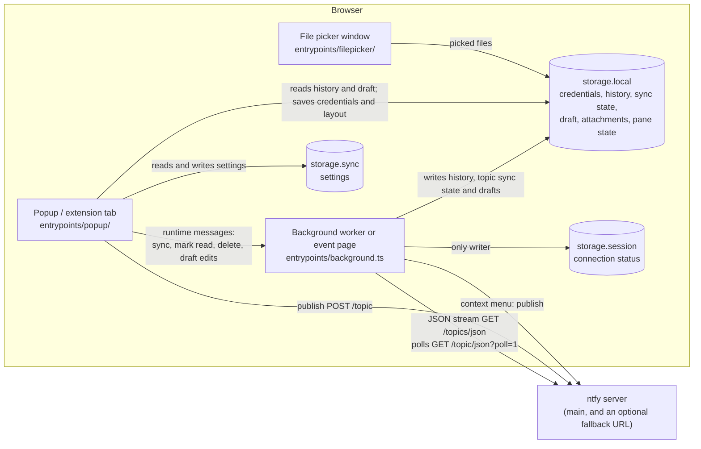

# Architecture

How ntfy Desk works. See [README.md](README.md) for installation and setup, and [AGENTS.md](AGENTS.md) for repository conventions and commands.

ntfy Desk is a Manifest V3 browser extension for Chrome (and Chromium browsers) and Firefox, built with [WXT](https://wxt.dev) and TypeScript. It does two things against an [ntfy](https://ntfy.sh) server:

- **Send**: publish a message, optionally with attachments, to a topic (from the popup or the right-click menu).
- **Receive**: subscribe to topics, show desktop notifications, keep a message list per topic and an unread count on the toolbar icon.

## Overview



The background owns the subscription, catch-up polls, received-message history, desktop notifications, unread badge and context menu. It runs as a service worker on Chromium and as an event page on Firefox. The popup and extension tab share the same page for sending, browsing the inbox and editing settings. They communicate with the background through storage and runtime messages.

## Components

| Path | Role |
|---|---|
| `entrypoints/background.ts` | Registers every listener at startup (MV3 requires it): storage changes, the one-minute alarm, the context menu, notification clicks, messages from the popup. Starts the receiver. |
| `entrypoints/popup/` | Send form and its disclosure preference (`send.ts`), inbox (`receive.ts`), settings (`settings.ts`) and resizable dividers (`pane-dividers.ts`). `?mode=page` selects the browser-tab layout. |
| `entrypoints/filepicker/` | A small window for picking files: the popup closes as soon as a file dialog opens, so files are picked here and stored for the popup. |
| `utils/ntfy.ts` | The ntfy API: configuration (`getConfig`), authentication headers, publishing, polls, the subscription stream, message validation (`parseMessage`). |
| `utils/receiver.ts` | Receiving: the subscription stream, the per-topic polls, reconnects, the service worker keepalive, the connection status. |
| `utils/history.ts` | Received messages, read and deleted ids, per-topic sync state; one write queue. |
| `utils/delete.ts`, `utils/sync-modes.ts` | Local and remote deletion requests and the per-topic opt-in to server deletion sync. |
| `utils/servers.ts` | Main and fallback server: health check, picking one, retrying a send on the fallback. |
| `utils/notifications.ts` | Desktop notifications (with `view` action buttons), notification clicks, the unread badge. |
| `utils/rules.ts` | Per-topic notification rules: all, from a priority up, or off. |
| `utils/status.ts` | The receiver's connection state for the inbox. |
| `utils/messages.ts` | Requests from the popup to the background, validated. |
| `utils/context-menu.ts` | Right-click menu: send the page, selection, link or image to a topic. |
| `utils/markdown.ts` | A small Markdown renderer that builds DOM nodes (no `innerHTML`). |
| `utils/zip.ts`, `utils/stored-files.ts` | Several attachments as one ZIP; attachments waiting for the next send. |
| `utils/extension-tab.ts` | Opens or focuses the extension's own tab. |

## Configuration and storage

| Area | Keys | Why there |
|---|---|---|
| `storage.sync` | `apiUrl`, `fallbackUrl`, `topics`, `includeUrl`, `notifyRules`, `syncDeletionTopics`, `theme`, `priority`, `lastTags`, `lastTopic`, `sendAnotherEnabled`, `sendAsZipEnabled`, `freezeDividers`, `rememberSendPanel` | Settings follow the user to their other browsers. Credentials belong in local storage. |
| `storage.local` | `accessToken`, `serverCredentials`, `authOrigins` | Credentials stay on this device. |
| `storage.local` | `receivedNotifications`, `readMessageIds`, `deletedMessageIds`, `topicSync` | Received messages and the sync state, per device. |
| `storage.local` | `storedFiles`, `draftState`, `receiveTopicFilter` | Attachments, draft and last inbox filter. `receiveTopicFilter` stores `{ topic }` for a specific topic or `null` for All topics. Legacy string values still load. |
| `storage.local` | `popupTopicsPaneWidth`, `popupSendPaneWidth`, `topicsPaneWidth`, `sendPaneWidth`, `sendPanelOpen` | Pane widths are separate for the popup and tab. The remembered Send disclosure state is shared on this device. |
| `storage.session` | `receiverStatus`, `sessionActive` | Gone after a browser restart: no stale connection state; a new session drops the old draft and attachments. |

`getConfig()` in `utils/ntfy.ts` is the one place that assembles the configuration for requests. It:

- reads the server URLs and topics from `storage.sync` and the token and username/password from `storage.local`;
- moves `user:password@` from valid legacy URLs into `storage.local`, strips query strings and fragments, and clears invalid legacy URL values from synced storage;
- withholds the credentials from server origins not approved on this device (see [Security model](#security-model)).

Data keyed by topic is stored as lists (`[topic, value]` pairs, or objects with a `topic` field) and read into a `Map`, because topic names such as `__proto__` are valid in ntfy and break plain objects.

## Receiving

Receiving combines a **live subscription** with **per-topic polls**:

```mermaid
sequenceDiagram
  participant SW as Service worker (receiver)
  participant N as ntfy server
  participant S as storage.local

  SW->>N: GET /<topic>/auth for each topic (readable?)
  SW->>N: GET /<readable topics>/json (Authorization header)
  N-->>SW: 200, then one JSON line per event
  SW->>N: GET /<topic>/json?poll=1&since=<watermark> per topic
  N-->>SW: missed messages
  SW->>S: record (dedupe, history, sync state in one write)
  loop every 20 s while subscribed
    SW->>SW: runtime.getPlatformInfo() (keeps the worker alive)
  end
  N-->>SW: message line
  SW->>S: record; desktop notification if new
  Note over SW: Every minute (alarm): connect() and sync()
```

### Connecting

`receiver.connect()` runs when the service worker starts, when the settings or credentials change, and every minute from an alarm. Each run:

1. Reads `getConfig()`. Without a server or topics it stops and shows nothing.
2. Picks the server (`pickServer`): the main URL if `/v1/health` answers or there's no fallback, else the fallback if it answers. Checking every minute lets it switch back when the main server returns.
3. Checks read access per topic (`GET /<topic>/auth`). ntfy rejects a multi-topic subscription with 403 if any topic isn't readable, and a topic the token can only publish to is a normal setup, so the receiver subscribes to (and polls) the readable topics only. The inbox marks the others "send only". The result is cached for an hour, or until a subscription is refused.
4. Subscribes, unless the current subscription already has the same server, topics and authentication.

A `connect()` that an `await` made stale (the settings changed meanwhile) stops instead of subscribing with old settings (`connectGeneration`).

### The subscription stream

The subscription is ntfy's JSON stream: `GET /<topic1>,<topic2>/json`, answered with `200` and then one JSON object per line: an `open` event, `message` events, and a `keepalive` event every 45 seconds by default. It is an ordinary `fetch` with the `Authorization` header (`openMessageStream`), read line by line (`readLines`):

- Each chunk is read only after the lines before it were stored, so a server sending faster than the extension can store is slowed down by TCP rather than queued in memory.
- Each line goes through `parseMessageJson`. Subscribed topics record `message` events, and topics with deletion sync enabled also apply `message_delete` events.
- A line longer than `MAX_MESSAGE_JSON` is dropped.

The stream ends in one of four ways, each followed by a reconnect with backoff (5 s doubling to 60 s): the server closes it, the network fails, the server refuses it (an HTTP error; a refusal before it opened also discards the cached read-access check), or nothing arrives for `STREAM_IDLE_TIMEOUT` (150 s). The last one matters because a connection that dies silently produces no event on a stream.

### Keeping the service worker alive

Chrome stops an extension service worker after 30 seconds without activity. Incoming data on a `fetch` stream doesn't count as activity, but an extension API call does, so while subscribed the receiver calls `browser.runtime.getPlatformInfo()` every 20 seconds (`KEEPALIVE_INTERVAL`). If the worker is stopped anyway (browser idle, update, crash), the one-minute alarm starts it again, and the polls fetch what it missed.

### Catch-up polls and deduplication

Live messages alone would miss everything published while the browser was closed or the stream was down. So every topic is also polled: when the stream opens, every minute, and when the popup opens.

Each topic has a sync state in `topicSync`:

- `origins` identifies the main and fallback aliases. An unrelated server, or a legacy cursor without origins, starts with a fresh poll.
- `since` holds the newest event time a completed poll covered. The next poll asks for `since=<watermark>` (inclusive). Live events leave the watermark in place so the next poll can catch up on earlier events.
- `seen` tracks the id and time of events at or after the watermark to deduplicate the inclusive replay.
- `serverDeletions` tracks up to 1000 recent deletion events by sequence ID, so overlapping live delivery and polls can't reinsert an older version.
- `synced`: whether the topic's first poll finished. The first poll loads the last 24 hours **silently** (no desktop notifications), so adding a topic doesn't flood the desktop.

Polls use time watermarks per topic, never one global `since=<message id>`: ids are global across topics, and an expired id makes ntfy replay its whole cache.

Catch-up reads NDJSON incrementally and retains the newest 1,000 eligible events, up to 4 MiB of event JSON. If a response exceeds the 64 MiB scan limit, the next poll resumes from the saved prefix's watermark. If another bounded poll at that watermark cannot advance past the same second, it moves to the next second. The inbox warns for 24 hours when the extension drops events at a limit or detects ntfy's truncation header. [ntfy replay limits](https://docs.ntfy.sh/subscribe/api/#replay-limits)

Enabling deletion sync schedules a one-time replay from the oldest saved message for the topic on the configured server. The replay applies cached delete events and recovers sequence IDs for existing rows. Ordinary message delivery and its watermark use the regular catch-up poll. The pending replay survives worker restarts and retries after failures. A new generation invalidates a replay started before a mode change.

Deletion sync is opt-in per topic. A `message_delete` event removes matching messages from that server's main or fallback origin, in the same topic and sequence, up to the event timestamp. The receiver uses message IDs for notifications without sequence IDs. A cached publish that matches an older message's ID, topic and time can recover its origin and sequence before deletion. Deletion markers share the topic cursor's server scope. A poll applies events in time order, preserving the server's order within a second. This allows a republish after a deletion to revive a sequence and suppresses desktop alerts for messages already deleted in the same poll. Cache expiry leaves local history intact. [ntfy deletion API](https://docs.ntfy.sh/publish/#deleting-notifications)

### History and the single writer

The background is the only writer of the received messages, the read and deleted ids and the sync state. The stream, the polls and the popup's actions all go through one queue (`serialized` in `utils/history.ts`). A live event or a completed poll writes its sync state and history together, so a failed write can't mark a message seen without storing it.

The popup sends `setRead` and `delete` requests through `utils/messages.ts`. The background serializes the local updates, so actions from open views cannot overwrite one another. For topics with deletion sync enabled, `utils/delete.ts` follows the local update with an authenticated `DELETE /<topic>/<sequence_id>` using `getConfig`. It checks the message's stored source origin against the configured server and fallback. For older history without a source origin, a bounded poll verifies the original message ID and timestamp on the current server. The request refuses redirects and ntfy checks topic write access. Delete all sends one request per selected sequence with bounded concurrency. The inbox reports denied or unconfirmed deletions after removing the local copies. [ntfy deletion API](https://docs.ntfy.sh/publish/#deleting-notifications)

The history keeps the newest 100 messages per topic by server time, up to 8 MiB in all. Local deletion removes the selected rows and saves their IDs in one write. The separate replay-suppression list holds up to 200,000 IDs, enough for one deletion of the entire history.

### Notifications and the badge

A message new to the history triggers `notifyNewMessage` when the topic's rule allows it (`utils/rules.ts`). High and urgent priorities set `requireInteraction`. A click opens the message's `click` URL or highlights the message in the extension's tab. Chromium notification buttons open HTTP(S) view actions first, then the attachment if space remains. The unread badge is recomputed when history or the read and deleted ids change.

### Connection status

The receiver writes its state to `storage.session` (`utils/status.ts`): connecting, connected, reconnecting (with the retry time), server unreachable, no readable topic, topics whose poll failed, the fallback in use, credentials held back. The header shows the active connection. The inbox shows warnings and errors above the list.

## Sending

The popup and extension tab share one inbox and Send form. The Send form uses a native disclosure and collapses to a rail on the right, leaving the draft in place. A narrow extension tab stacks the sections and collapses Send in place. Send opens expanded by default. With the synced remember setting enabled, both views reopen in the last state saved in `storage.local`. A specific inbox filter sets the send destination. All topics restores the independent choice stored in `lastTopic` or the draft. The filter stays local to each open view so a change in another view cannot redirect a send.

The toolbar popup requests 800 × 600 px for the main view, and the full-page view fills the tab. In both layouts, content scrolls below the header and the inbox list uses the remaining height beneath its controls. Settings swaps the gear for a back arrow in the same slot. The dividers resize the Topics and Send panes while reserving space for the inbox. The synced freeze setting disables pointer and keyboard resizing. The topic settings table stages deletion modes and notification rules until Apply writes both to synced storage.

The Send form publishes with `POST /<topic>`: the message as the body, title, priority and tags as headers (RFC 2047-encoded when they contain anything outside printable ASCII, including line breaks). Attachments are sent as the body with `X-Filename` (and the message in `X-Message`), one request per file, or several files as one ZIP (`utils/zip.ts`).

- The popup closes when a file dialog opens, so files are picked in a separate window (`entrypoints/filepicker/`) and wait in `storage.local` as data URLs until sent. Each edit immediately dispatches a draft save to the background. Sending and opening the file picker await that save. The background serializes writes and clears a draft only when its revision matches the successful send. Drafts and attachments are dropped when a new browser session starts.
- With "Fill in the current tab" (`includeUrl`), the page's title goes in the Title field and its URL in the Message field; a field the user typed in is left alone, and filled values aren't saved in the draft. Context menu sends put the page URL in the title. In the extension's own tab, "Use tab" asks once for the optional `tabs` permission to find the page used last.
- The right-click menu sends the page, the selection, a link or an image (`utils/context-menu.ts`). An image is fetched and sent as an attachment, which asks for access to that image's site.
- Before publishing, the composer verifies that its main and fallback URLs still match current settings and that the selected topic still exists. Sending retries on the fallback URL when the main server gives no response (network error or timeout). An HTTP error ends the attempt.

Every request has a time limit (`TIMEOUTS` in `utils/ntfy.ts`).

## Security model

The extension handles two kinds of untrusted input: the **server** (or anyone who can publish to a subscribed topic) and **synced settings** (which another browser can change). The credentials must only ever reach the user's ntfy server.

**Credentials**

- Credentials entered in the access token or username and password fields live in `storage.local`. The settings editor saves only valid HTTP(S) URLs or empty fields. It uses `splitCredentials` to move userinfo to the local credentials fields and discard query strings and fragments before syncing the URLs.
- Credentials are bound to the server origins approved on this device (`authOrigins`). Saving server URLs in this browser's settings approves them. A URL changed elsewhere, such as browser sync from another browser, gets no credentials until the user confirms in the settings; `getConfig` enforces it (`heldBackFrom`), and every request takes its authentication from `getConfig`.
- Credentials travel only in the `Authorization` header, never in a URL (see the next section). "Open in ntfy" opens the server without credentials in the address.
- Authenticated requests refuse redirects (`redirect: 'error'`): the browser keeps the `Authorization` header on a same-origin redirect, which could point at any path, and ntfy publishes on GET.
- ntfy's CORS answer (`Access-Control-Allow-Headers: *`) doesn't cover `Authorization`, so authenticated requests need host access to the server's site. It is an optional permission, asked for with the "Allow access to this server" button only when credentials are set.
- With an `http://` server and credentials, the settings show a warning: the credentials would cross the network unencrypted.

**Server content**

- Every message is validated before it is stored, and again when the history is read (`parseMessage`): types are checked, unknown fields dropped, invalid messages discarded.
- Event lines are capped at 32 KiB of text. Catch-up retains a bounded batch and limits the scan as described above. Only messages of subscribed or polled topics are stored.
- Topic names must match ntfy's topic syntax in the settings form, when reading synced settings, and when building API requests. [ntfy topic names](https://docs.ntfy.sh/publish/#picking-a-topic)
- Messages are rendered with `textContent` only; Markdown through `utils/markdown.ts`, which builds DOM nodes. Bare URLs become links (`linkify`) only if they are http(s). Each message renders on its own, so one that fails shows a placeholder instead of breaking the list.
- URLs from messages are opened, linked or copied only if they are `http(s)`. Image previews load only the server's own attachment route (`/file/<name>`), because other same-origin URLs can be API calls.

**Permissions**: `storage`, `unlimitedStorage` (attachments as data URLs), `notifications`, `alarms`, `contextMenus`, `activeTab`, `scripting` (the text of a link sent from the context menu, read from the page). `tabs` and host access are optional and requested when a feature needs them. The default MV3 content security policy applies (no remote or inline scripts).

## Why WebSockets were dropped

Until October 2026 the extension subscribed with ntfy's WebSocket endpoint (`wss://server/<topics>/ws`), as the [Ntfy-for-chrome](https://github.com/paulhybryant/Ntfy-for-chrome) extension it descends from did.

### The problem

Browsers can't set headers on a WebSocket. ntfy works around that by accepting the `Authorization` value in a query parameter: `?auth=<base64url of "Bearer tk_..." or "Basic ...">`. That is an encoding, not encryption: anyone who sees the URL recovers the token or the username and password. TLS protects it on the wire, but the full URL is written down in places outside the extension's control:

- **The browser**: a failed WebSocket connection is logged with its full URL on the extensions page's Errors list and in the service worker's DevTools console, and network logs exported from the browser contain it.
- **The server side**: reverse proxies (nginx, Caddy, Traefik), CDNs such as Cloudflare, and ntfy's own request logs record the full request URI, query string included. Whoever can read those logs, or an export of them, can recover the credentials.

The extension never logged that URL itself, but it couldn't keep the browser or the proxies from doing so. A security review rated this as a finding that could only be mitigated (dedicated tokens, log redaction) as long as the WebSocket stayed.

### The alternative

ntfy offers the same subscription as a long-lived HTTP response: `GET /<topics>/json` streams one JSON object per line. Being an ordinary `fetch`, it carries the credentials in the `Authorization` header like every other request: nothing secret in the URL, and proxies don't log `Authorization` by default.

The open question was the MV3 service worker. With the WebSocket, the extension sent a small frame every 20 seconds, and WebSocket activity keeps Chrome's service worker alive. Would a streaming `fetch` do the same?

### The experiment

Three test extensions ran in Playwright's Chromium, launched directly with no DevTools or CDP attached (an attached debugger keeps a service worker alive by itself). Each one sent a heartbeat to a local test server every 10 seconds, so the worker's lifetime was observed from the server side only.

| Variant | Setup | Result |
|---|---|---|
| A | Streaming `fetch`; the server writes a line every 20 s | Stopped after ~36 s. Incoming stream data does not count as activity. |
| B | Streaming `fetch`; the server writes every 45 s (ntfy's default); the worker calls `runtime.getPlatformInfo()` every 20 s | Alive for the whole 8.5-minute run, on a single start, with the stream open throughout and every line received. The documented 5-minute limit on a single request did not cut the stream. |
| C | Control: nothing open | Stopped after ~34 s. |

### The decision

The extension switched to variant B: the JSON stream with the `Authorization` header, plus an extension API call every 20 seconds while subscribed.

What it changed besides removing `?auth=`:

- **Clearer errors**: a refused subscription is an HTTP status (401 or 403) instead of a WebSocket closing without a reason.
- **One request path**: the stream goes through the same `fetch` code as polls and sends, with the same redirect policy.
- **Backpressure**: reading the stream one chunk at a time after storing the lines before it replaced a cap on queued live messages.
- **A watchdog**: a stream gives no close event when a connection dies silently, so the receiver gives up on one that sends nothing for 150 seconds (`STREAM_IDLE_TIMEOUT`); ntfy's keepalives normally arrive every 45 seconds.
- **No new permission**: authenticated servers already needed host access; anonymous ntfy allows the stream from any origin.

The trade-offs accepted:

- **Reverse proxies must not buffer the response.** With nginx that is `proxy_buffering off`, which ntfy's docs already recommend for streaming. A buffering proxy delays live messages until the next poll (at most a minute), it doesn't lose them.
- **The keepalive depends on Chrome counting extension API calls as activity.** The WebSocket keepalive depended on a comparable rule, so the risk is about the same, and the one-minute alarm plus the polls cover a stopped worker either way.
- **Firefox** (whose MV3 background is a non-persistent event page) still needs to be run-tested, as it did with the WebSocket.

## Testing

- **Unit tests** (`tests/`, Vitest with WXT's fake browser): `tests/helpers/fake-ntfy.ts` is a fake ntfy server behind `fetch`, following ntfy v2.29's `since=` semantics, with `FakeStream` for subscriptions (accept, refuse, deliver, end; deliver resolves once the receiver has handled the line). Popup tests load the real `index.html` in happy-dom. `regressions.test.ts` and `security.test.ts` hold one test per review finding.
- **End-to-end tests** (`e2e/`, Playwright Test): the built extension in Playwright's Chromium against `e2e/ntfy-server.ts`, a real HTTP server with the JSON stream. It accepts credentials only in the `Authorization` header, so the tests also prove they never go in a URL.
- **Checks**: `pnpm check` (format, lint with type checking, unit tests), `pnpm test:e2e`, `pnpm lint:firefox` (Mozilla's add-on checks). CI runs all three.
- **Build version**. WXT uses `package.json` as the source of the version in both manifests and ZIP filenames. CI attaches the ZIPs to workflow runs. The release job publishes the ZIPs for `v*` tags after the checks pass.
