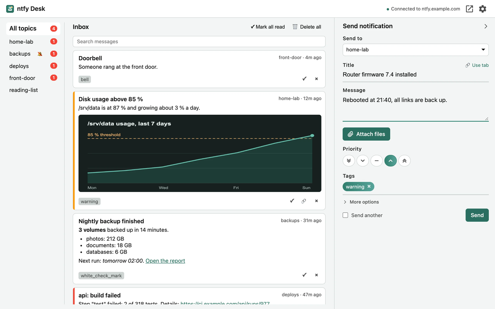

<p align="center">
  
</p>

# ntfy Desk

Send and receive [ntfy](https://ntfy.sh) notifications in your browser. Messages arrive live as desktop
notifications and wait in an inbox per topic; send a note, a file or the page you're on in a few keystrokes.

[Website](https://ntfy-desk.minddevops.eu) ·
[Setup instructions](https://ntfy-desk.minddevops.eu/setup-instructions) ·
[Privacy policy](PRIVACY.md)

[](https://ntfy-desk.minddevops.eu)

> [!IMPORTANT]
> ntfy Desk is in review at Firefox Add-ons and the Chrome Web Store (Chrome, Edge and Vivaldi). Until it is published there,
> install a release build using the [instructions below](#install). It works with ntfy.sh and self-hosted servers,
> in Chromium browsers 116+ and Firefox 142+. It is unofficial and not affiliated with the ntfy project.

## What it does

- Receive messages live, as desktop notifications and an unread count on the toolbar icon.
- Catch up on messages sent while the browser was closed, as far as the server still keeps them.
- Read, search and filter messages per topic, with Markdown, links and image previews.
- Choose per topic which messages notify you: all, from a minimum priority, or none.
- Send a title, message, priority, tags and attachments, with a click URL or a delivery time.
- Send the current page, selected text, a link or an image from the right-click menu or a shortcut.
- Use it in the toolbar popup or a full browser tab, in light or dark mode.
- Keep credentials on your device, with no account or analytics, and back up your settings to a file.

## Install

Published versions, extension ZIPs and matching source archives are available on [GitHub Releases](https://github.com/valentindimitrov/ntfy-desk/releases) when a release is published. For preview builds, use the `ntfy-desk` artifact on a successful [CI run](https://github.com/valentindimitrov/ntfy-desk/actions/workflows/ci.yml). Downloading a CI artifact requires signing in to GitHub.

- **Chromium 116 or later**. Download and extract the `-chrome.zip` file. Open the browser's extensions page, turn on **Developer mode**, then choose **Load unpacked** and select the folder containing `manifest.json`.
- **Firefox 142 or later**. For a permanent installation, use a signed add-on when one becomes available. The Firefox ZIP from GitHub is for [temporary testing](#load-a-local-build). [Firefox signing and distribution](https://extensionworkshop.com/documentation/publish/signing-and-distribution-overview/)

ntfy Desk doesn't run in private windows: its drafts, queued files and messages are stored with the regular profile.

## Setup

The settings (gear icon) have five tabs: **Server** (items 1 to 4 below), **Topics** (5 and 6), **Messages** (7 to 9: Notifications, Inbox and Sending), **Appearance** (the theme, **Topic list** beside or above the inbox, **Freeze dividers** and **Remember collapsed/expanded state**) and **More** (10 and 11). The arrow keys, Home and End move between the tabs. Settings opens on **Server** while something there needs you (no server yet, server access not granted, or a server to confirm for your credentials), otherwise on the tab used last; a dot marks a tab with something to fix. Below the tabs are links to the project on GitHub, its website, its issues page (**Contact**) and its optional tip page (**Tip**).

Use an HTTPS server and a topic with access controls for sensitive messages. Anyone who can read a public topic can receive what you send to it. Start with a harmless test message. [ntfy quick start](https://docs.ntfy.sh/)

1. **Server URL**. Use `https://ntfy.sh` or your own server. Choose **Save server settings** to commit the URLs and credentials together. The back arrow asks before discarding unsaved changes to those fields. Both URL fields accept a valid HTTP(S) address or an empty value. Username and password in the URL move into local fields. Query strings and fragments are discarded.
2. **Fallback URL** (optional). Use another address of the same server, such as its public address when the main address is on your LAN. Receiving checks for the main server's return every minute. Sending chooses the reachable address before publishing. If the response to an immediate send goes missing, the composer keeps the draft and asks you to check the inbox before retrying. For a delayed send it warns instead that the message appears in the inbox only when it is delivered, so sending again can deliver it twice. Right-click sends show a `?` on the toolbar when delivery is uncertain.
3. **Access Token**, or **Username and password**. Enter credentials in these fields so they are stored on this device only. The extension uses them only with server origins approved on this device. A server URL changed through browser sync requires confirmation before requests to it use your credentials. The settings warn if an `http://` connection would send credentials unencrypted.
4. **Allow access to this server** appears when credentials or deletion sync are configured and host access is missing. Access lets the extension send authenticated requests and read replay headers that the browser may otherwise hide. This applies to both sites when you use a fallback URL.
5. **Topics**: enter names of up to 64 letters, digits, dashes or underscores. The extension receives from the topics your credentials can read. Topics with write-only access appear as send only.
6. **Topic settings** lists message sync, desktop notification rules and send defaults for each topic. Choose **Apply** to save the columns together. **Send priority** is **Last used** by default; choosing a priority gives the topic its own starting priority and **Send tags** (up to 10, separated by commas, or none) in the Send form. **Keep received messages** is the default and keeps deletes on this device. **Sync server deletions** checks saved messages against deletion events still available in ntfy's cache and follows future deletion events. Switching to an unrelated server preserves the previous server's history. Delete and Delete all request server deletion only for the messages the inbox indicated would also be deleted on the server, while the same server is still configured and deletion sync remains enabled. The local copy is removed even if the server denies deletion or the extension skips it or cannot confirm it. In those cases the inbox shows a warning. [ntfy deletion API](https://docs.ntfy.sh/publish/#deleting-notifications)
7. **Notifications**. **Unread badge counts** chooses what the number on the toolbar icon covers: all topics (the default), or only topics whose desktop notifications aren't off. The inbox counts every topic either way. **Keep high and urgent notifications on screen until dismissed** is on by default; it is a Chromium option and isn't shown in Firefox.
8. **Inbox**. **Messages kept per topic** is 100 by default. A lower value removes each topic's oldest messages right away, and a higher one doesn't bring them back; all topics together stay within 8 MiB. **Message times** shows relative times (the default) or always the local date and time. **Density** tightens the message rows without hiding anything.
9. **Fill in the current tab** (under Sending, on the Messages tab): puts the page's title in the Title field and its URL in the Message field. It also adds the page's URL to right-click sends: as the title of a **Text** or **Image** send, and below the link in the message of a **Link** send (whose title is the link's text, when it can be read). The **Page** item and the **Send this page to ntfy** shortcut always send the page's title and URL. In the extension's own tab, **Use tab** fills in the page you were on last (it asks once for permission to read tabs).
10. **Keyboard shortcuts** lists the current keys. **Change shortcuts** opens the browser's page for them (`chrome://extensions/shortcuts` in Chromium browsers, **Manage Extension Shortcuts** in Firefox). Alt + Shift + N is suggested for opening ntfy Desk, where it is free; **Send this page to ntfy** has no key until you choose one. Ctrl + Enter (Cmd + Enter on a Mac) sends from the expanded Send form.
11. **Backup**. **Export settings** downloads `ntfy-desk-settings-<date>.json` with the server and fallback URL, the topics with their topic settings, and every preference. It never contains the access token, the username and password or received messages, but it does list your server addresses and topic names, which is all it takes to read a topic on a server without access control, so treat it as private. **Import settings** reads such a file, shows the server URLs and the number of topics it brings, and after **Replace settings** replaces all of these settings (it doesn't merge; a setting the file lacks returns to its default). Values the file holds that aren't valid are named and left out. Your token and password stay on the device, and aren't sent to an imported server this device hasn't approved until you choose **Use them with this server** under Server (the import opens that tab when there is a server to confirm). Importing needs a file dialog, so from the toolbar popup it continues in the extension's tab; in Firefox so does exporting.

### Receiving and the browser

The extension subscribes with ntfy's JSON stream (`/<topics>/json`), which sends the credentials in the `Authorization` header like every other request, never in the URL. (A WebSocket can't carry headers, so it would need them in the URL, where browser error lists and proxy access logs keep them.)

Chrome stops an idle extension service worker after 30 seconds, and data arriving on the stream doesn't count as activity, so the extension makes a small extension API call every 20 seconds while subscribed. If nothing arrives for 2½ minutes (ntfy sends a keepalive every 45 seconds by default), it reconnects. Missed messages are also polled once a minute. A large catch-up can omit cached events when it reaches the extension's limits or ntfy truncates the response. The inbox shows a warning for the affected topics. [ntfy replay limits](https://docs.ntfy.sh/subscribe/api/#replay-limits)

Behind a reverse proxy, turn off response buffering for ntfy (nginx: `proxy_buffering off;`, as ntfy's docs recommend), or live messages only arrive with the next poll.

## Development

Built with [WXT](https://wxt.dev) and TypeScript. [ARCHITECTURE.md](ARCHITECTURE.md) describes how the extension works and why. Unit tests use [Vitest](https://vitest.dev) with WXT's fake browser; end-to-end tests use [Playwright](https://playwright.dev) with the built extension and a test ntfy server; [Vite+](https://viteplus.dev) lints and formats.

Use Node.js **24** and pnpm **12.14.0**, as in CI. For a reproducible build, start from the tag or source ZIP matching the extension package and install from the lockfile.

```bash
pnpm install --frozen-lockfile
pnpm dev            # Chrome with hot reload (pnpm dev:firefox for Firefox)
pnpm check          # format check, lint with type checking (Vite+), unit tests (Vitest)
pnpm test:e2e       # isolated .output/chrome-mv3-e2e build and Playwright tests
pnpm browse         # build, then open the extension in playwright-cli
pnpm build          # .output/chrome-mv3, load it unpacked
pnpm zip            # .output/ntfy-desk-<version>-chrome.zip (pnpm zip:firefox)
pnpm lint:firefox   # build and run Mozilla's add-on checks
pnpm website:build  # the website, into .output/website
pnpm verify:packages  # check the ZIPs in .output before a release
```

For end-to-end tests, install the browser once with `pnpm exec playwright install chromium`. On a clean Linux runner, use `pnpm exec playwright install --with-deps chromium`. The interactive `pnpm browse` command uses the separate `playwright-cli` tool and its own browser install (`playwright-cli install-browser chromium`).

### Load a local build

- **Chromium**. Run `pnpm build` and load `.output/chrome-mv3` from the browser's extensions page.
- **Firefox**. Run `pnpm build:firefox`. Open `about:debugging#/runtime/this-firefox`, select **Load Temporary Add-on**, and choose `.output/firefox-mv3/manifest.json`. You can also select the Firefox ZIP. The temporary installation lasts until Firefox restarts.

`pnpm zip` produces the Chromium ZIP. `pnpm zip:firefox` produces the Firefox ZIP and a matching sources ZIP for review and distribution. `pnpm verify:packages` checks the three files against the checkout. A release attaches them to a draft GitHub release through the manually started **Prepare release** workflow; publishing it is done by hand, and the manually started **Publish to stores** workflow submits a published release to both stores ([docs/releasing.md](docs/releasing.md), [docs/store-publishing.md](docs/store-publishing.md), store text in [`assets/store-listings/`](assets/store-listings/README.md)). For Mozilla submission, provide the sources ZIP and the Firefox build instructions above. [Mozilla source code submission](https://extensionworkshop.com/documentation/publish/source-code-submission/)

Code layout:

- `entrypoints/background.ts`: listeners of the service worker.
- `entrypoints/popup/`: the popup (also the page opened in a tab): `send.ts`, `receive.ts`, `settings.ts`.
- `entrypoints/filepicker/`: the window for picking files (the popup closes when a file dialog opens).
- `utils/`: ntfy API (`ntfy.ts`), receiving (`receiver.ts`, `history.ts`), notifications and badge, context menu, ZIP.
- `tests/unit/` contains the Vitest suite and a fake ntfy server that follows ntfy v2.29's `since=` semantics.
- `tests/e2e/` contains the Playwright suite and its HTTP test ntfy server.
- `scripts/browse.ts` opens the extension in an interactive browser via `pnpm browse`.
- `website/` contains the public website and its [README](https://github.com/valentindimitrov/ntfy-desk/blob/main/website/README.md) (not in the sources ZIP).
- `scripts/validate-packages.ts`, `scripts/sign-chrome.ts` and `scripts/crx3.ts` check and sign the release packages ([docs/releasing.md](docs/releasing.md)); `scripts/publish-stores.ts` submits them to the stores ([docs/store-publishing.md](docs/store-publishing.md)).

## Support ntfy Desk

[Optional tips](https://buy.stripe.com/28E00kdpS4Tm9uW7QF5c401) support development and do not unlock features. Contact: the [issues page](https://github.com/valentindimitrov/ntfy-desk/issues).

## Credits

ntfy Desk began as a port of these two extensions; its code, styles and icon have since been rewritten:

- [Send to ntfy](https://github.com/TheDuffman85/send_to_ntfy_extension) by TheDuffman85: the sending extension (popup, context menu, attachments, ZIP).
- [Ntfy-for-chrome](https://github.com/paulhybryant/Ntfy-for-chrome) by paulhybryant: receiving (WebSocket, message list, unread badge, desktop notifications).

Both are GPL-3.0, and so is ntfy Desk.

## License

[GNU General Public License v3.0](LICENSE). The bundled Roboto fonts use Apache-2.0. See the [license notices](NOTICE.md) for attribution and license files.
